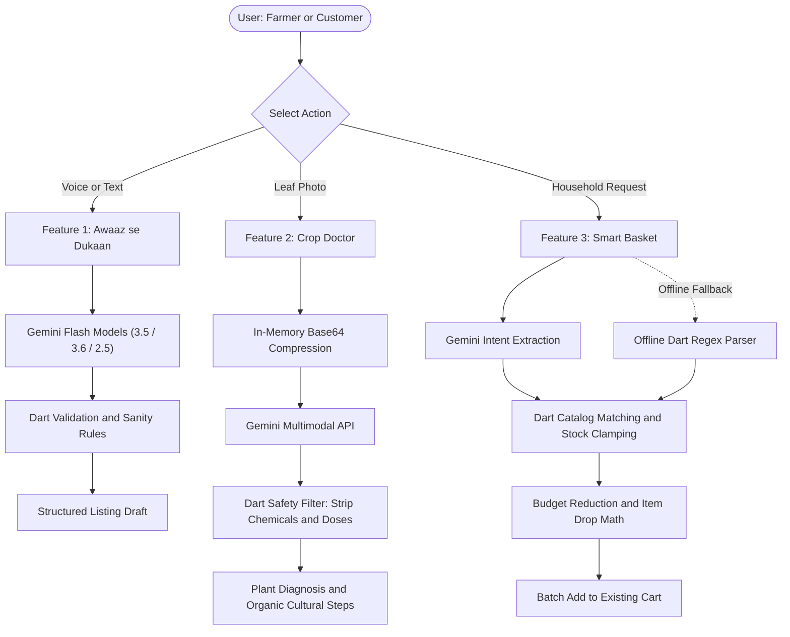

# HarvestHub 🌱🛒
### *Direct Farm-to-Table Marketplace with On-Device & Cloud AI*

[](https://flutter.dev)
[](https://dart.dev)
[](https://firebase.google.com)
[](https://ai.google.dev)
[](#tests--quality-assurance)
[](#tests--quality-assurance)
[](https://lnkd.in/p/dR3N3VdK)
[](https://lnkd.in/p/d_Da_mJV)

---

## 👨‍💻 Project Overview & Creator

- **Project**: **HarvestHub 🌱🛒**
- **Created & Developed By**: **Hani Afzal**
- **Domain / Track**: **Agriculture (AgriTech, AI & Food Security)**

---

## 🌾 The Problem We Are Solving

Agriculture is the backbone of developing economies like Pakistan, contributing over 22% of GDP and employing 37% of the labor force. Yet, the supply chain suffers from severe systemic vulnerabilities:

1. **The Middleman Trap (*Aarthi* System)**:
   Smallholder farmers receive only **20% to 30%** of the retail market value of their produce. Intermediaries dictate unfair margins, while urban consumers pay inflated prices for stale produce.
2. **Post-Harvest Crop Loss & Disease Misdiagnosis**:
   Farmers lose up to **35% of crop yields** each season due to untreated leaf diseases. Small farmers in remote areas have virtually zero access to agriculture extension officers or plant pathologists, often leading to improper pesticide use that poisons soil and water.
3. **High Digital & Literacy Barriers for Farmers**:
   Most e-commerce solutions demand complex English text forms, category trees, and decimal inventory management. Rural growers who cannot read or write fluently are excluded from modern platforms.
4. **Inflation & Urban Budgeting Crisis**:
   Urban families struggle with volatile food inflation. Planning a weekly household grocery basket within a strict monthly budget is stressful and time-consuming.
5. **Language Barrier**:
   Existing apps offer English-only interfaces, ignoring native languages like **Urdu** and **Roman Urdu** commonly spoken across farm communities and urban households.

---

## 💡 The Solution: HarvestHub

**HarvestHub** is a direct farm-to-consumer digital marketplace bridging rural farmers and urban buyers without predatory intermediaries.

- **Direct Farmer Dukaan**: Farmers publish daily harvests directly from their fields with transparent pricing and scheduled pickup/drop-off slots.
- **Fair Consumer Pricing**: Customers buy fresh, harvested-that-morning produce at wholesale-adjacent prices.
- **Spark-Compliant Zero-Cost Architecture**: Built strictly on Flutter, Riverpod, and Firebase's free **Spark Plan** (no Cloud Functions, no Firebase Storage, no Blaze fees), enabling sustainable deployment for grassroot rural initiatives.

---

## 🤖 3 Core AI Features (Built for Agriculture)

**HarvestHub** integrates three purpose-driven AI systems designed and developed by **Hani Afzal** using Google's **Gemini Developer API** with zero-cloud-storage image handling and custom offline Dart engines.



---

### 1. 🎙️ Feature 1: "Awaaz se Dukaan" (Voice-to-Listing for Farmers)
*Empowering illiterate and non-tech-savvy farmers to list their produce in seconds using their voice.*

- **Multilingual NLU**: Accepts spoken Urdu, Roman Urdu, and English (e.g. *"20 kilo taaza desi tamatar 150 rupay kilo me bechna hai"*).
- **Auto-Extraction**: Gemini parses crop name, category, quantity, unit, and fair price range directly into a structured product draft.
- **Dart Integrity Engine**: Validates quantities, bounds price ranges to prevent accidental typos, and sets up the product form automatically.
- **Zero Typing Required**: Farmers simply speak into their microphone and hit "Publish".

---

### 2. 🩺 Feature 2: "Crop Doctor" (AI Leaf Disease Diagnosis)
*An instant plant pathologist in every farmer's pocket.*

- **In-Memory Leaf Scanning**: Farmers snap a leaf photo via camera or gallery. The image is compressed and sent as inline base64 data to Gemini—**zero images are stored on Cloudinary or Firestore**, guaranteeing zero latency overhead and zero storage costs.
- **Strict Chemical & Dosage Safety Filters**:
  To protect crops and human health, Dart runs deep regex filters ([`_chemicalRegex`](file:///D:/DDrive/harvesthub_new/lib/services/crop_doctor_service.dart), [`_doseRegex`](file:///D:/DDrive/harvesthub_new/lib/services/crop_doctor_service.dart)) that strip out any unverified chemical pesticides or dosage recommendations. It returns **only safe, organic, cultural steps** (e.g., pruning, airflow, morning watering, sanitation).
- **Non-Plant Detection**:
  If a farmer accidentally photographs a shoe, car, or tool, the AI detects `isPlant: false` and politely instructs them to photograph a leaf.
- **Bilingual Interface**: Toggle seamlessly between **English** and **Roman Urdu** (*"Podon ka Doctor"*).
- **Mandatory Disclaimer**: AI estimates are explicitly marked, advising farmers when to escalate issues to local agricultural extension officers.

---

### 3. 🧺 Feature 3: "Smart Basket" (AI-Powered Shopping Basket Builder)
*Helping families fight food inflation with intelligent budget matching and stock-aware grocery planning.*

- **Natural Language Shopping**: Consumers type natural language requests:
  - Household prompt: *"5 log, Rs 3000, hafta bhar ki sabzi"*
  - Specific item prompt: *"2 kg tamatar, 1 dozen kela, 3 kg aloo"*
- **Strict Dart-Controlled Maths**:
  Per security rules, the AI **never** sees the product catalog, **never** sets prices, and **never** writes to Firestore. The AI only extracts quantities and items. All matching against live stock, price calculation, and inventory checks happen inside Dart.
- **Stock Clamping & Unit Mismatch Flags**:
  Quantities are rounded up to whole integers, capped to current inventory, and if the requested unit differs from what the farmer sells (e.g., *piece* vs *dozen*), a `"Check quantity"` warning tag is shown.
- **Automatic Budget Balancer**:
  If a customer's basket exceeds their budget (e.g., Rs 3000):
  1. It reduces quantities of the lowest-priority items down to 1.
  2. If still over budget, it drops items from the bottom one-by-one until it fits.
  3. Clearly informs the customer: *"Reduced Palak quantity to 1"*, *"Dropped Mango to fit budget"*.
- **Offline Fallback Engine**:
  If offline, rate-limited (HTTP 429), or encountering network timeouts, an internal Dart parser splits phrases, reads quantities, and extracts items locally with zero crashes.
- **One-Click Cart Integration**: Customers inspect the matched items and press `"Add all to cart"` to seamlessly merge them into their existing shopping cart.

---

## 🛡️ Robust AI Architecture & Resilience Rules

All AI features follow strict enterprise-grade resilience principles:
- **Fallback Model Cascade**: `gemini-3.5-flash-lite` → `gemini-3.6-flash` → `gemini-2.5-flash`.
- **Single Concurrency Lock**: Active locks (`_isRequestInProgress`) prevent accidental double-tap duplicate requests.
- **Client Rate Limiting**: Built-in 6 requests/minute rolling throttle per device.
- **12-Second Network Timeout**: Guaranteed no hanging screens or infinite loading indicators.
- **Smart Retries**: Automatic 1-second retry on server errors (500/503), with zero retry on 429 quota exhaustion to preserve quota.
- **Zero PII Exposure**: No user names, phone numbers, addresses, emails, or IDs are ever sent to Gemini. Only the prompt text or leaf pixels are transmitted.

---

## 🎬 Live App Walkthrough (Customer Journey)

> **Note**: Due to GitHub repo file size limits, full HD video walkthroughs showcasing the **Customer Experience** are hosted on LinkedIn *(Farmer & Admin walkthroughs coming soon)*:

- 📺 [**Customer Journey Walkthrough — Part 1**](https://lnkd.in/p/dR3N3VdK): Catalog browsing, fresh harvest discovery, and real-time local farmer listings.
- 📺 [**Customer Journey Walkthrough — Part 2**](https://lnkd.in/p/d_Da_mJV): "Smart Basket" AI budgeting assistant, automated item clamping, cart checkout, and order tracking.

---

## 🛠️ Tech Stack

| Layer | Technology |
|---|---|
| **Framework** | Flutter 3.24+ (Dart 3.6+) |
| **State Management** | Flutter Riverpod (StateNotifierProvider, AutoDispose) |
| **Backend & Auth** | Firebase Authentication & Cloud Firestore (Spark Free Plan) |
| **AI / Machine Learning** | Google Gemini Developer API (Multimodal 3.5-flash-lite / 3.6-flash / 2.5-flash) |
| **Local Offline Cache** | SQLite encrypted via SQLCipher |
| **Media Handling** | Image Picker with client-side 80% JPEG compression (no cloud storage) |
| **Monitoring** | Firebase Crashlytics & Analytics |
| **Target Platform** | Android (minSdkVersion 21, targetSdkVersion 34) |

---

## 📂 Project Structure

```text
lib/
├── core/                        # Validators, retry logic, constants, logger
├── models/
│   ├── crop_diagnosis.dart      # Crop Doctor diagnostic models & safe fallback steps
│   ├── smart_basket.dart        # Smart Basket requested items, basket lines, & results
│   ├── voice_listing_draft.dart # Voice-to-listing drafts
│   ├── product_model.dart       # Core product model with stockQty, price, unit
│   ├── order_model.dart         # Order tracking & pickup slot models
│   └── user_model.dart          # Customer, farmer, and admin models
├── services/
│   ├── crop_doctor_service.dart # Gemini leaf diagnosis, chemical stripping regexes
│   ├── smart_basket_service.dart# Gemini shopping list parser, offline fallback, budget math
│   ├── voice_listing_service.dart# Farmer voice transcription & product structuring
│   ├── cart_service.dart        # Firestore transactional cart operations
│   └── product_service.dart     # Catalog queries & stock operations
├── providers/
│   ├── crop_doctor_provider.dart# Riverpod state: idle, processing, result, Roman Urdu
│   ├── smart_basket_provider.dart# Riverpod state: processing, ready, budget adjustments
│   ├── cart_providers.dart      # Live cart items, subtotal, and promo deductions
│   └── catalog_providers.dart   # Stream of active in-stock farm products
├── screens/
│   ├── customer/
│   │   ├── home/                # Catalog screen with "Smart Basket" banner
│   │   ├── smart_basket_screen.dart # Smart Basket UI, stepper review, budget bar
│   │   └── cart/                # Cart & order confirmation
│   ├── farmer/
│   │   ├── crop_doctor_screen.dart  # Leaf camera/gallery scan, tips, & diagnosis card
│   │   ├── voice_listing_modal.dart # "Awaaz se Dukaan" voice recorder modal
│   │   └── products/            # Farmer inventory management with Crop Doctor card
│   └── admin/                   # Marketplace analytics, farmer verification, promo codes
└── widgets/                     # Reusable UI cards, headers, buttons, & badges
```

---

## 🧪 Tests & Quality Assurance

HarvestHub features a comprehensive test suite of **146 automated tests** covering security, Dart budget math, safety filters, and responsive layout scaling:

```bash
# Run all unit and widget tests
flutter test

# Result:
# 00:20 +146: All tests passed!
```

### Verified Test Suites
1. **Smart Basket Tests** ([`smart_basket_test.dart`](file:///D:/DDrive/harvesthub_new/test/services/smart_basket_test.dart)):
   - Offline fallback parser handling `"2 kg tamatar, 1 dozen kela"`.
   - Budget regex extraction (`"Rs 3000 budget"`, `"3000 rupees"`).
   - Household-only prompt detection (`"5 log hafta bhar"`).
   - Prompt-injection bounding (malicious JSON clamped to 1-15 items, qty ≤ 100).
   - Live product stock clamping and unit mismatch detection.
   - Budget reduction and item dropping sequence.
   - Concurrency lock protection against double-taps.
2. **Crop Doctor Tests** ([`crop_doctor_test.dart`](file:///D:/DDrive/harvesthub_new/test/services/crop_doctor_test.dart)):
   - Non-plant identification (`isPlant: false`).
   - Chemical name & dosage stripping.
   - Safe cultural steps fallback.
   - Roman Urdu language toggle.
3. **Core Validation & Logic Tests**:
   - Customer phone number formatting, email safety, and name validation.
   - Responsive layouts tested at 320px–360px with font scaling up to 200%.

### Code Analysis
```bash
flutter analyze

# Output:
# Analyzing harvesthub_new...
# No issues found! (ran in 5.4s)
```

---

## 🚀 Setup & Installation Guide

### Prerequisites
- [Flutter SDK](https://docs.flutter.dev/get-started/install) (version 3.24 or higher)
- Android Studio / VS Code with Dart & Flutter plugins
- Android device or emulator running API 21+

### Step-by-Step Setup

1. **Clone the repository**:
   ```bash
   git clone https://github.com/YourRepo/harvesthub.git
   cd harvesthub_new
   ```

2. **Install Flutter dependencies**:
   ```bash
   flutter pub get
   ```

3. **Configure Environment Variables**:
   Copy `.env.example` to `.env` in the project root:
   ```env
   GEMINI_API_KEY=your_gemini_api_key_here
   CLOUDINARY_CLOUD_NAME=your_cloud_name
   CLOUDINARY_UPLOAD_PRESET=your_preset
   ONESIGNAL_APP_ID=your_onesignal_id
   PUSH_RELAY_URL=https://your-worker.workers.dev
   ```

4. **Verify Analyzer & Tests**:
   ```bash
   flutter analyze
   flutter test
   ```

5. **Run the Application**:
   ```bash
   flutter run
   ```

---

## 👥 Pre-Seeded Test Accounts

The platform includes pre-seeded and verified test accounts ready for instant evaluation without email confirmation hurdles:

| Role | Name & Business | Email | Password | Purpose |
|---|---|---|---|---|
| **Customer** | **Hani Afzal** | `hani.afzal@harvesthub.test` | `Customer@Harvest26` | Test "Smart Basket", Cart, Fresh Orders & Notifications |
| **Farmer** | **Hani Afzal** (*Afzal Green Orchards*) | `hani.farmer@harvesthub.test` | `Farmer@Harvest26` | Test "Awaaz se Dukaan" Voice Listing, Inventory & "Crop Doctor" |
| **Admin** | **Hani Afzal (Admin)** | `admin@harvesthub.test` | `Admin@Harvest26` | Platform Overview, Manage Farmers & Promo Codes |

*Note: For Google Sign-In, `haniafzal96@gmail.com` is also pre-configured as an active customer account with live notifications and order history.*

---

## 🌍 Social & Economic Impact (UN SDGs)

HarvestHub directly aligns with the **United Nations Sustainable Development Goals**:
- **SDG 1 (No Poverty)**: Increases farmer take-home income by 40–60% by eliminating middleman markups.
- **SDG 2 (Zero Hunger & Food Security)**: Rescues harvest yields with on-device disease diagnosis and connects unsold fresh food directly to consumers.
- **SDG 8 (Decent Work & Economic Growth)**: Bridges the digital divide for illiterate and marginalized rural growers.
- **SDG 12 (Responsible Consumption & Production)**: Recommends non-chemical, sustainable farming treatments, reducing hazardous chemical runoff into groundwater.

---

## 👨‍💻 Project Author

**HarvestHub is designed, architected, and built with ❤️ by Hani Afzal.**

*Watch the customer journey video walkthroughs on LinkedIn:*
- 📺 [**Customer Journey Walkthrough (Part 1)**](https://lnkd.in/p/dR3N3VdK)
- 📺 [**Customer Journey Walkthrough (Part 2)**](https://lnkd.in/p/d_Da_mJV)

---

## 📜 Release Notes & Changelog

See the full release history and milestone breakdown in [CHANGELOG.md](CHANGELOG.md).

